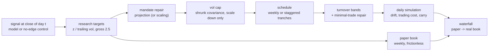

# target-to-book-simulator

[](https://github.com/Avinash186200/target-to-book-simulator/actions/workflows/ci.yml)
[](LICENSE)


Model target weights are not P&L. This repo takes weekly targets from a signal with a known, modest edge, turns them into a book a long-short desk could actually hold (mandate repair, vol cap, rebalance schedule, turnover bands, trading costs, carry), and measures what each step costs, step by step, over 10 held-out seeds, next to a no-edge control. Choices are made on separate development seeds; held-out results were never used for any choice.

It starts where an allocator stops. [vol-budgeted-model-allocation](https://github.com/Avinash186200/vol-budgeted-model-allocation) has a long-short optimiser with borrow cost and a turnover penalty; this repo takes the optimiser's output as given and asks what survives implementation.

## Scenario

A research team hands a portfolio desk model target weights every week for a long-short basket of twelve assets in four groups. The desk cannot hold them as they are. Its mandate has net-exposure limits per group (some groups may be held net short, within a bound), a cap on total net exposure, a gross cap and a per-position cap. Positions pay financing every day, and shorts pay more than longs. Trading costs money. There is an ex-ante volatility cap. Rebalancing every week is expensive, so the desk wants to know whether a slower or staggered schedule is better. The desk wants to know how much of the paper performance survives into a real book, and which implementation choices lose the most.

This is a scenario to frame the work. All data is synthetic, generated in this repo with a planted edge of known size, so every number below can be rebuilt with one command.

## What it does

| part | what I built | how it is judged |
|---|---|---|
| market and signal | 12 assets in 4 groups, one market factor and one factor per group, Student-t shocks, stochastic volatility; a slow true alpha drives next-day drift; the model signal is alpha plus faster noise; the control signal has the same dynamics and no information | tests check vols, that the model signal predicts the next day and the control does not, and that drift uses only the previous close |
| targets | the research team's convention: z-score of the signal, divided by trailing 63-day vol, scaled to gross 2.5; they ignore the mandate | every target is formed from data up to its hand-over day (tested by changing the future) |
| mandate repair | uniform max-feasible scaling (closed form) vs Euclidean projection onto the mandate (a QP solved with Clarabel, cross-checked against cvxpy in the tests) | exposure kept, distance to target, tracking error, return and Sharpe |
| vol cap | ex-ante vol from a trailing 252-day covariance with Ledoit-Wolf shrinkage of the correlations; scales down only | share of weeks it binds, loss in return, change in Sharpe |
| schedule | weekly, 2 tranches each rebalanced every 2 weeks, 4 tranches every 4 weeks (chosen on development seeds); single books at every phase for timing luck | Sharpe, turnover, spread across rebalance phases |
| turnover bands | a no-trade zone around each target, trade to the edge or all the way to the target; a minimal-trade repair when the banded book breaks the mandate | net Sharpe vs no band, chosen on development seeds at four cost levels |
| frictions | trading cost on drifted weights, per-group cost; daily carry on long and short exposure at separate rates | cost and carry drag per year |
| attribution | a waterfall from paper to real book, each stage adding one step, plus each step alone on the paper book | paired per-seed deltas, median and range over 10 held-out seeds, model and control |

## How it works



Every implementation choice (schedule, band width, band mode, band width per cost level) is made on development seeds 1-5; held-out seeds 101-110 are reported with the frozen choices; held-out results never used for any choice (held-out sections first read after the third full run; a fourth run only added diagnostic fields; see [docs/methodology.md](docs/methodology.md)). Each seed is an independent 11-year panel: one warm-up year for covariance and vol estimates, then ten evaluated years. Targets at day t use returns up to t; trades happen at the close of t and earn returns from t + 1.

## Results

All numbers are from synthetic data, copied from [results/RESULTS.md](results/RESULTS.md), which `make bench` rebuilds from scratch (about a minute with 5 processes). Cells are `median [min, max]` over the 10 held-out seeds; returns are annualised arithmetic excess returns in %. Deltas are paired per seed. A test checks that every table row below appears in RESULTS.md.

Development choice (5 seeds, every friction on): **2 tranches, each rebalanced every 2 weeks, with a 0.08 band in edge mode**. The three schedules were within 0.02 Sharpe of each other at their best band (0.971 to 0.987, standard errors about 0.17), so the schedule choice is a tie on this data; the band choice is not (see [docs/choosing-turnover-bands.md](docs/choosing-turnover-bands.md)).

<!-- results:start -->
### Waterfall: model signal (planted edge)

| stage | return % | Sharpe | vol % | gross | turnover / yr | delta return % | delta Sharpe | seeds with a loss |
|---|---|---|---|---|---|---|---|---|
| paper target (weekly, frictionless) | 8.29 [3.82, 14.27] | 1.04 [0.49, 1.78] | 7.92 | 2.50 | 80.3 | - | - | - |
| + mandate repair (projection) | 6.46 [3.62, 10.39] | 1.05 [0.61, 1.74] | 5.94 | 1.94 | 63.6 | -1.71 [-3.88, -0.20] | -0.01 [-0.20, 0.20] | 10/10 |
| + vol cap | 5.98 [3.66, 9.44] | 1.10 [0.69, 1.76] | 5.36 | 1.81 | 58.8 | -0.43 [-1.87, 0.04] | 0.04 [-0.04, 0.11] | 9/10 |
| + desk rebalance schedule | 5.61 [3.88, 9.62] | 1.15 [0.77, 1.93] | 5.02 | 1.72 | 38.7 | -0.20 [-1.21, 0.63] | 0.04 [-0.15, 0.18] | 6/10 |
| + trading costs (drifted weights) | 4.50 [2.81, 8.52] | 0.92 [0.56, 1.71] | 5.02 | 1.72 | 38.7 | -1.09 [-1.15, -1.05] | -0.22 [-0.25, -0.20] | 10/10 |
| + carry on long and short exposure | 3.86 [2.18, 7.86] | 0.79 [0.43, 1.58] | 5.02 | 1.72 | 38.7 | -0.64 [-0.66, -0.61] | -0.13 [-0.14, -0.12] | 10/10 |
| + turnover bands = real book | 3.72 [1.94, 7.32] | 0.84 [0.45, 1.71] | 4.36 | 1.55 | 19.8 | -0.35 [-1.01, 1.01] | 0.11 [-0.10, 0.29] | 7/10 |

Each step alone on top of the paper book:

| step alone | delta return % | delta Sharpe | seeds with a loss (return) |
|---|---|---|---|
| mandate | -1.71 [-3.88, -0.20] | -0.01 [-0.20, 0.20] | 10/10 |
| vol_cap | -1.44 [-3.09, -0.49] | 0.07 [-0.04, 0.20] | 10/10 |
| schedule | 0.04 [-1.78, 0.86] | 0.07 [-0.18, 0.25] | 5/10 |
| costs | -2.24 [-2.39, -2.12] | -0.28 [-0.32, -0.25] | 10/10 |
| carry | -0.90 [-0.94, -0.87] | -0.11 [-0.13, -0.10] | 10/10 |
| bands | -0.56 [-1.87, 1.10] | 0.04 [-0.20, 0.24] | 7/10 |

### Waterfall: no-edge control

| stage | return % | Sharpe | vol % | gross | turnover / yr | delta return % | delta Sharpe | seeds with a loss |
|---|---|---|---|---|---|---|---|---|
| paper target (weekly, frictionless) | 0.16 [-4.32, 4.15] | 0.02 [-0.54, 0.56] | 8.02 | 2.50 | 82.8 | - | - | - |
| + trading costs (drifted weights) | -1.10 [-3.93, 1.81] | -0.22 [-0.75, 0.36] | 5.15 | 1.71 | 39.1 | -1.10 [-1.15, -1.04] | -0.22 [-0.23, -0.20] | 10/10 |
| + carry on long and short exposure | -1.74 [-4.56, 1.18] | -0.34 [-0.87, 0.24] | 5.15 | 1.71 | 39.1 | -0.64 [-0.66, -0.62] | -0.12 [-0.14, -0.11] | 10/10 |
| + turnover bands = real book | -1.12 [-3.24, 1.16] | -0.27 [-0.73, 0.28] | 4.41 | 1.52 | 19.9 | 0.64 [-0.30, 1.94] | 0.10 [-0.14, 0.36] | 3/10 |

(The mandate, vol cap and schedule rows of the control are in RESULTS.md; none of them moves the median return by more than 0.3 points.)

### Rebalance-timing luck: one book every 4 weeks vs 4 staggered tranches

| signal | phase spread, return % | phase spread, Sharpe | single book Sharpe (all phases) | staggered Sharpe | staggered minus mean phase, Sharpe | weekly Sharpe |
|---|---|---|---|---|---|---|
| model | 1.52 [0.86, 2.17] | 0.34 [0.20, 0.57] | 0.71 [0.15, 1.71] | 0.90 [0.37, 1.62] | 0.10 [0.04, 0.19] | 0.84 [0.48, 1.65] |
| control | 1.59 [0.52, 3.23] | 0.35 [0.12, 0.69] | -0.24 [-1.07, 0.29] | -0.29 [-0.70, 0.25] | -0.03 [-0.09, 0.02] | -0.31 [-0.72, 0.34] |

### Mandate repair: projection vs uniform scaling (model signal)

| book | measure | projection | scaling | projection minus scaling |
|---|---|---|---|---|
| mandate only | return % | 6.46 [3.62, 10.39] | 3.19 [1.78, 4.94] | 3.34 [1.34, 5.45] |
| mandate only | Sharpe | 1.05 [0.61, 1.74] | 0.99 [0.54, 1.45] | 0.09 [-0.11, 0.29] |
| mandate only | gross | 1.94 [1.92, 1.96] | 1.01 [0.89, 1.12] | 0.93 [0.84, 1.03] |
| real book | return % | 3.72 [1.94, 7.32] | 2.14 [0.88, 4.13] | 1.51 [0.95, 3.19] |
| real book | Sharpe | 0.84 [0.45, 1.71] | 0.85 [0.34, 1.62] | 0.11 [-0.18, 0.26] |

### Turnover bands at four cost levels (band chosen on development seeds)

| cost x | band | mode | Sharpe with band | Sharpe, no band | delta | seeds better | turnover: band / none |
|---|---|---|---|---|---|---|---|
| 0.5 | 0.08 | edge | 0.90 [0.51, 1.77] | 0.90 [0.54, 1.69] | 0.058 [-0.150, 0.245] | 6/10 | 19.8 / 38.7 |
| 1 | 0.08 | edge | 0.84 [0.45, 1.71] | 0.79 [0.43, 1.58] | 0.108 [-0.100, 0.291] | 7/10 | 19.8 / 38.7 |
| 2 | 0.12 | edge | 0.79 [0.27, 1.62] | 0.56 [0.22, 1.35] | 0.168 [-0.110, 0.519] | 7/10 | 14.5 / 38.7 |
| 4 | 0.12 | edge | 0.60 [0.07, 1.43] | 0.11 [-0.21, 0.91] | 0.414 [0.147, 0.753] | 10/10 | 14.5 / 38.7 |
<!-- results:end -->

What I read from this:

- **Less than half of the paper return survives.** Paper to real book, paired: -4.95 [-7.33, -1.40] points per year; the pooled share kept (mean real over mean paper) is 44% (30% to 63% per seed). Sharpe falls from 1.04 to 0.84 (medians), and the real book's correlation with the paper book is 0.76 [0.72, 0.78].
- **Return and Sharpe tell different stories.** The mandate repair, the vol cap and the schedule each cut return, but none of them moves median Sharpe down by more than 0.01: they mostly take risk off (gross 2.50 to 1.72, vol 7.92% to 5.02%). Only trading costs and carry cut Sharpe in every seed (-0.22 and -0.13 in the ladder, after mandate, vol cap and schedule). If the desk is judged on return per unit of risk, costs and carry are the losses that matter; if it is judged on return, the mandate is the biggest single step (-1.71).
- **The order of the steps matters.** The vol cap costs 1.44 points alone but 0.43 after the mandate repair, because the repair has already taken leverage off. Costs cost 2.24 points alone on the weekly paper book but 1.09 after the slower schedule. The ladder deltas add up exactly to the paper-to-real total per seed; the "alone" table shows how much each number depends on what came before it.
- **The control is a clean check.** With no edge, paper Sharpe is 0.02 [-0.54, 0.56], and the costs and carry rows lose almost exactly what they lose for the model signal (-1.10 and -0.64 points). The control's real book has Sharpe -0.27: implementing a signal with no edge is not free.
- **Projection keeps twice the exposure of uniform scaling.** Both repairs keep the shape problem in view, but one breached group limit shrinks the whole scaled book: gross 1.01 against 1.94. Projection earns 3.34 points more on the repaired book. Its Sharpe advantage is small and not consistent (+0.09 [-0.11, 0.29]).
- **Timing luck is large; staggering removes it and helps a little.** Picking a different week to rebalance a 4-weekly book moves Sharpe by 0.34 [0.20, 0.57] within the same seed, for the control as much as for the model. Four staggered tranches beat the average phase by 0.10 Sharpe in all 10 seeds with the model signal, mostly through lower vol (3.93% vs 4.46%). Part of that is mechanical diversification across rebalance dates rather than better trading: with the control signal the same staggering changes Sharpe by -0.03. They also hold less gross (1.39 vs 1.56) because tranches with different-age targets net against each other. For the control, staggering does not help (-0.03).
- **Bands pay for themselves when costs are high, and are a coin flip when costs are low.** At four times the scenario cost the chosen band improves Sharpe in 10 of 10 held-out seeds (+0.41); at half the scenario cost it is better in 6 of 10 and the median gain is +0.06. At the scenario cost level smaller bands were more consistent on held-out seeds (0.02 in edge mode was better in 10 of 10) than the 0.08 chosen on development seeds (7 of 10). On development seeds edge mode beat target mode at every band up to 0.12 and lost at 0.24, where an edge-mode book barely trades and falls far behind its targets.
- **Bands interact with the mandate.** Keeping old positions often pushes the book over the gross cap, so the minimal-trade repair runs at 226 of 503 tranche rebalances in the real book (median).

## Key concepts

- **Mandate repair.** All constraints are convex and contain zero, so the largest feasible uniform multiple has a closed form (one ratio per constraint). The projection solves `min ||x - w||^2` over the mandate; it can never be farther from the target than the scaled book (tested).
- **Blending feasible books.** A convex blend of feasible books is feasible under these constraints (all convex, tested). What blending breaks is a gross *target*: positions net, so gross falls. Staggered tranches are such a blend, which is why the staggered book holds less gross.
- **Turnover on drifted weights.** A trade goes from the weights the book drifted to, not from last week's target. Without bands the two measures agree to within 0.1% per year here; with bands the holdings are no longer the last target and turnover counted between targets is about twice the real one (ratio 0.510 [0.490, 0.532] in RESULTS.md).
- **Carry on long and short exposure.** A short pays a different financing rate from a long, so a short is not the negative of a long. Carry is charged on beginning-of-day positions and paid from NAV.
- **Vol cap with a shrunk covariance.** Ledoit-Wolf intensity on standardised returns shrinks correlations toward zero (mean intensity 0.107 here); variances stay at their sample values. The cap scales the book down only.
- **Turnover bands.** A no-trade zone of half-width h around each target. Edge mode trades only to the edge of the zone, which is the classic answer for proportional costs; target mode trades all the way. Edge mode also lags the target and holds less exposure.
- **Timing luck.** A book rebalanced every N weeks depends on which week it trades. N tranches on offset weeks average that away; their combined NAV is exactly the mean of the N single books (tested).
- **Development vs held-out seeds.** Choices on seeds 1-5, reports on seeds 101-110 with the choices frozen; held-out results were never used for any choice. The held-out sections were first read after the third full run; a fourth run, after review, only added diagnostic fields. The history, including one widening of the band grid before any held-out result was read, is in [docs/methodology.md](docs/methodology.md).

## Quick start

```bash
pip install -c constraints.txt -e ".[dev]"   # exact versions the results were made with
pytest -q                                     # summaries recomputed from runs.json; one held-out and one development seed rerun
make demo                                     # one seed, the waterfall printed
make bench                                    # full rerun: writes results/*.json, RESULTS.md and manifest.json
make verify                                   # rerun every seed and check it against results/runs.json
```

A walkthrough of one seed is in [docs/walkthrough.md](docs/walkthrough.md); how to pick a band is in [docs/choosing-turnover-bands.md](docs/choosing-turnover-bands.md).

## Layout

```
src/targetbook/
  data.py         synthetic market, planted alpha, model and control signals
  targets.py      the research team's weekly targets
  mandate.py      mandate, uniform scaling, projection and minimal-trade repair (Clarabel QPs)
  risk.py         Ledoit-Wolf shrunk covariance, ex-ante vol, vol cap
  book.py         daily simulator: tranches, drift, bands, trading cost, carry
  metrics.py      return, Sharpe, drawdown, turnover, tracking error
  pipeline.py     one seed end to end: books at each stage, every configuration
  bench.py        development choices, held-out runs, summaries, RESULTS.md, manifest
  cli.py          targetbook bench | report | demo
tests/            unit tests per module; summaries, manifest and a seed subset checked against results/
results/          runs.json (per-seed records), summaries, RESULTS.md, manifest.json (config + SHA-256)
docs/             methodology, walkthrough, choosing turnover bands
```

## Limitations

- **Synthetic market, one shape of edge.** The alpha is a single AR(1) per asset with a 60-day half-life and the noise has a 10-day half-life. A faster-decaying edge would make the slower schedules and wide bands look worse; a slower one, better. The size of each waterfall step depends on these choices; the method of measuring them does not.
- **The frictions are scenario numbers, not estimates.** Trading cost 1 to 5 bps per unit traded, carry 10 to 30 bps per year on longs and 30 to 80 on shorts. They are plausible orders of magnitude, not calibrated to any market. The cost sweep (0.5x to 4x) shows how the band answer moves with them.
- **Costs are linear.** No market impact growing with trade size, no bid-ask that widens in stress, no partial fills. With impact costs, bands and slower schedules would be worth more.
- **The vol cap is applied to the target, not the held book.** After staggering and bands the real book runs at 4.36% vol against a 6% cap, so the cap rarely matters at the end of the chain. A desk that caps the held book daily would trade more.
- **The schedule choice is a tie.** Weekly, 2 x 2-weekly and 4 x 4-weekly were within 0.02 Sharpe on development seeds with standard errors near 0.17. The chosen 2 x 2-weekly is one reasonable pick, not a proven best.
- **The band chosen on development seeds was not the most consistent on held-out seeds.** 0.08 in edge mode won on development seeds; on held-out seeds 0.02 and 0.04 were better than no band in more seeds, with smaller median gains. Ten seeds cannot separate them.
- **Ten held-out seeds, ten years each.** The Sharpe of a 10-year sample has a standard error of about 0.3, so levels vary a lot across seeds (paper Sharpe 0.49 to 1.78). The paired deltas are much tighter, which is why the waterfall reports them.
- **Medians do not add up.** The ladder deltas add up exactly per seed; their medians need not add up to the median total.
- **Minimal-trade repair is one choice.** When a banded book breaks the mandate, the repair minimises the L1 change from the banded book plus an L2 tie-break term. A cost-weighted objective, or repairing toward the target, would trade differently. Not benchmarked here.
- **The mandate is enforced only at rebalances.** Between hand-overs positions drift; in the real book gross exceeded the 2.0 cap on 0.12 [0.00, 0.75]% of days, reaching at most 2.029 (RESULTS.md). A desk that enforces the cap daily would trade more.
- **No execution lag.** Targets are formed and traded at the same close. A one-day lag would cost more for the faster schedules; it is not in the waterfall.

## License

MIT. See [LICENSE](LICENSE).
